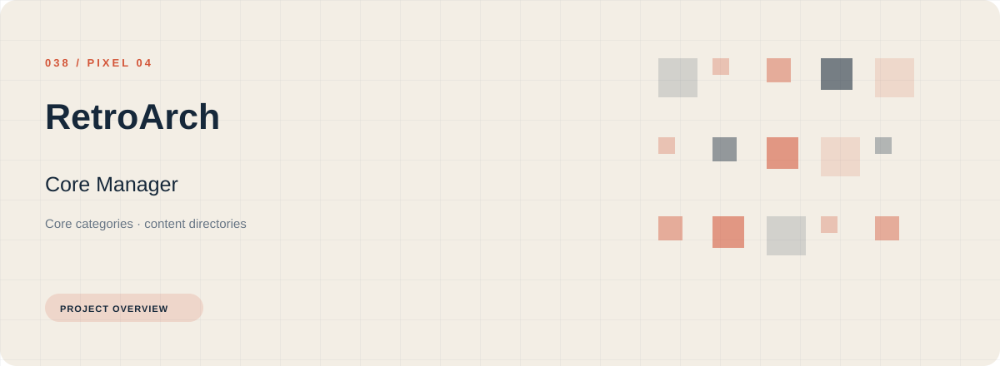
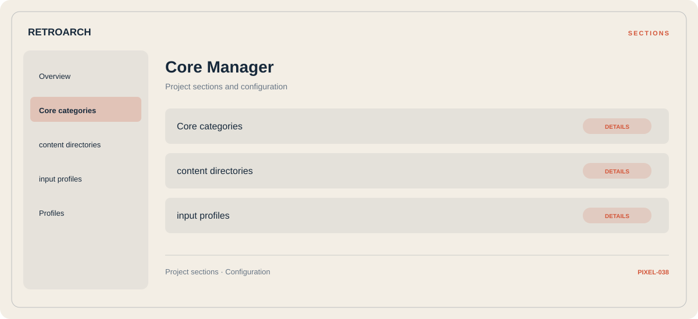

# ⚡ RetroArch Core Manager

**Core categories · Content directories · Input profiles**

## ⚡ Features

RetroArch Core Manager uses a concise workspace for core categories, content directories, and input profiles. The feature map follows the same order as the project navigation.

### ⚙️ Core categories

Content and resource groups, together with their configuration or organization details.

### 🧩 Content directories

Content and resource groups, together with their configuration or organization details.

### ⌨️ Input profiles

Related settings collected into named groups for a clearer configuration workflow.

## 🖥️ Project navigation

## 📥 Download

The button and cover open the project's download page. Use the information supplied with the downloaded package for installation and release-specific requirements.

## 📚 Project documentation

- [Feature reference](docs/FEATURES.md)
- [Download information](docs/DOWNLOAD.md)
- [Project page](index.html)

---

RetroArch Core Manager · Program documentation and download information.
